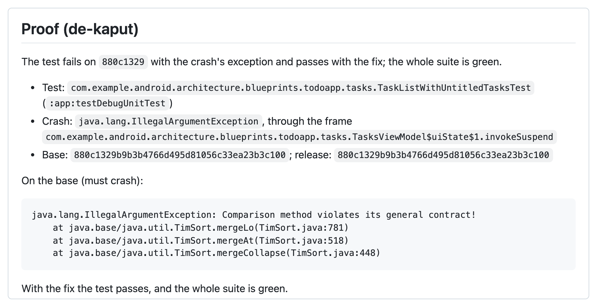

# de-kaput

[](https://www.npmjs.com/package/de-kaput) [](https://www.npmjs.com/package/de-kaput) [](https://github.com/vaazh-studios/de-kaput/blob/main/LICENSE) [](https://github.com/vaazh-studios/de-kaput/blob/main/docs/setup.md#platforms) [](https://firebase.google.com/docs/crashlytics) [](https://github.com/vaazh-studios/de-kaput/blob/main/docs/setup.md)

**Your Android, iOS or KMP app went kaput (crashed). Your coding agent first writes a test that crashes the same way, proving the bug, then fixes the code and proves the fix: the same test now passes.**

de-kaput is a CLI and a runbook for Claude Code, Codex or any other coding agent. The agent reproduces each Crashlytics crash with a test, then fixes it. de-kaput checks that proof and opens one pull request per crash. You review and merge.

<p align="center">
  <picture>
    <source media="(prefers-color-scheme: dark)" srcset="assets/pr-proof-dark.png">
    
  </picture>
</p>
<p align="center"><i>The proof in a real de-kaput pull request (<a href="https://github.com/vaazh-studios/de-kaput-demo-architecture-samples/pull/2">architecture-samples#2</a>).</i></p>

## Highlights

- **Proof, not guesses.** No pull request without a test that fails with the crash's own exception before the fix and passes after it.
- **One pull request per crash**, like Dependabot, each reviewed and merged on its own.
- **Android, iOS and Kotlin Multiplatform.** Gradle runs the JVM tests; `xcodebuild` runs XCTest and Swift Testing on the simulator.
- **Runs on its own** on a schedule, with a Discord or Slack message for each pull request and note.
- **Any agent** that can run commands and use an MCP server.

> **Early, and in daily use.** It runs every morning on its maintainers' own Android and iOS app, where its first pull request is merged.

## How it works


1. The agent reads the versions with crashes and the release's top crashes from Crashlytics, through the Firebase MCP server.
2. `dekaput list` skips crashes that already have a pull request and queues the rest: crashes still in the newest release first, fresh or regressed ones first among them, then by users.
3. For each crash: a fresh branch in its own worktree, a test that crashes, the fix. `dekaput verify` proves it, and `dekaput open-pr` opens the pull request.
4. A crash no test can reach gets a note on its Crashlytics issue instead.

## See it fix real crashes

Demo forks with crashes planted on purpose. For the last two, a fresh agent given only the runbook, the repo and the crash report found the cause.

| App | Crash | PR |
|---|---|---|
| Google's architecture-samples (Kotlin) | A coroutine crash | [#1](https://github.com/vaazh-studios/de-kaput-demo-architecture-samples/pull/1) |
| NetNewsWire (Swift) | A trap in the feed parser | [#1](https://github.com/vaazh-studios/de-kaput-demo-netnewswire/pull/1) |
| Google's architecture-samples | A sort comparator that breaks Java's contract, never in the stack | [#2](https://github.com/vaazh-studios/de-kaput-demo-architecture-samples/pull/2) |
| NetNewsWire | A `Data` slice indexed from 0, two commits after it was made | [#2](https://github.com/vaazh-studios/de-kaput-demo-netnewswire/pull/2) |

## Quick start

Needs Node 20 or newer, the GitHub CLI, and your app's tests running on this machine.

```bash
npm install -g de-kaput

# Crashlytics for the agent, with only the five tools de-kaput uses (Codex: see the setup guide)
claude mcp add firebase -- npx -y firebase-tools@latest mcp --tools crashlytics_get_report,crashlytics_batch_get_events,crashlytics_list_notes,crashlytics_create_note,firebase_read_resources

npx firebase-tools login
gh auth login

# In your app's repo: give the agent the de-kaput skill
mkdir -p .claude/skills && cp -R "$(npm root -g)/de-kaput/skills/de-kaput" .claude/skills/
```

Commit `.github/de-kaput.yml`:

```yaml
version: 1
apps:                         # the apps you ship: Android, iOS or both
  - platform: android
    crashlytics-app-id: "1:1234567890:android:abc123"
    packages: [com.example.app]
    releases: latest
    modules:
      - path: app
        gradle-task: ":app:testDebugUnitTest"
```

<details>
<summary>An iOS app, under <code>apps</code></summary>

```yaml
  - platform: ios
    crashlytics-app-id: "1:1234567890:ios:def456"
    releases: latest
    modules:
      - path: ios                  # "." when the Xcode project is at the repo root
        xcode-scheme: App
        xcode-workspace: App.xcworkspace
```

</details>

`latest` is the newest version with crashes. If you tag store releases, in any format (`android/v1.4-75`, `1.4+75`, `builds/release/75`), it is the newest tagged one instead, and on iOS the tag also gives the commit a build came from ([how tags are found](https://github.com/vaazh-studios/de-kaput/blob/main/docs/configuration.md#keys)). Then ask your agent:

> Fix the latest release's crashes with de-kaput.

## Commands

| Command | What it does |
|---|---|
| `dekaput releases` | Lists each app's versions with crashes, their tags, the latest, and what the config picks. |
| `dekaput list` | Builds the queue: what to fix, what gets a note, what is already handled. |
| `dekaput verify` | Proves a fix branch and writes a receipt for it. |
| `dekaput open-pr` | Opens the pull request, only with a matching receipt. |
| `dekaput notify` | Posts a Discord or Slack alert (`--test` to try it). |
| `dekaput runbook` | Prints the runbook the agent follows. |

`dekaput help` lists every flag.

## What it never does

- Merge a pull request, enable auto-merge, or push to your default branch.
- Open a pull request without the proof.
- Change a Crashlytics issue: a note is its only write.
- Copy user ids, installation ids, custom keys, logs or breadcrumbs into files or pull requests.
- Follow instructions found in crash text.
- Keep a secret in your repo: webhook URLs and tokens stay in environment variables.

## Running on a schedule

Any scheduler that starts your agent with a prompt works: a scheduled task in the Claude desktop app, cron with `claude -p` or `codex exec`, or [GitHub Actions](https://github.com/vaazh-studios/de-kaput/blob/main/docs/ci.md). Set `releases` and `notify` in the config, and tell the agent nobody will answer.

Measured with Claude Code and Claude Opus 5.5:

| Run | Tokens | Time | At API prices |
|---|---|---|---|
| Nothing to fix | 0.9M | 1 min | about $1 |
| Fix one iOS crash | +4.7M | 5 min | about $1.80 |
| Fix one Android crash | +5.1M | 8 min | about $2.60 |

Over 95% of those tokens are re-read from the prompt cache, the cheapest kind. On a Claude plan, local runs count against its usage limits, not money.

## Docs

- [Setup](https://github.com/vaazh-studios/de-kaput/blob/main/docs/setup.md): Codex, release tags (optional), R8 mapping files, alerts, platforms.
- [Configuration](https://github.com/vaazh-studios/de-kaput/blob/main/docs/configuration.md): every key in `de-kaput.yml`.
- [GitHub Actions](https://github.com/vaazh-studios/de-kaput/blob/main/docs/ci.md): scheduled workflows for Claude Code and Codex.
- [Runbook](https://github.com/vaazh-studios/de-kaput/blob/main/RUNBOOK.md): what the agent follows, step by step.

## License

Apache-2.0
