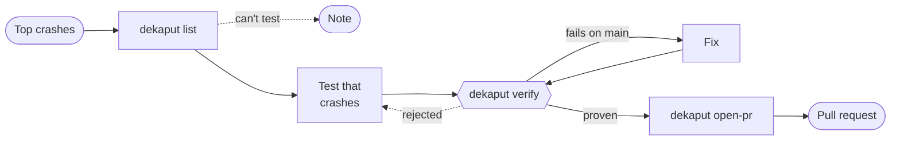

# de-kaput

Your app went kaput. de-kaput reproduces the crash with a test, fixes it, and opens a pull request with the test and the fix.

It never fixes blind: no pull request without a test that fails with the crash's own exception before the fix and passes after it. A person always reviews and merges.

> **Status: early.** The first goal is one crash going end to end, from Crashlytics to a pull request with its test. Configuration comes after that. See [docs/plans](docs/plans).

## How it works

1. Your coding agent (Codex or Claude Code) reads the latest release's top crashes from Crashlytics through the Firebase MCP server.
2. `dekaput list` ranks them and picks the next one without a pull request.
3. The agent writes a test that reproduces that one crash, then fixes it.
4. `dekaput verify` proves it: the test fails on your default branch with the crash's exception, reaching the crash's code, and passes with the fix, with the module's tests green. It writes a receipt.
5. `dekaput open-pr` refuses without that receipt, then opens a normal pull request with the test, the fix and the proof.

One crash per run. If the test already passes on your default branch but crashes on the release, the crash is already fixed and not yet shipped; the pull request adds the test so it stays fixed.

Built for native Android, native iOS and Kotlin Multiplatform apps. Gradle first; Xcode next.

## Use it with your agent

- **Claude Code:** copy `skills/de-kaput/` into your project's `.claude/skills/`, then ask "fix the next crash with de-kaput".
- **Codex:** add one line to your project's `AGENTS.md`: "To fix a Crashlytics crash, follow RUNBOOK.md from vaazh-studios/de-kaput, one crash per run."

Until the npm package is published, run the CLI from a clone: `node <clone>/bin/dekaput.mjs` in place of `npx @vaazh-studios/de-kaput`.

## License

Apache-2.0
