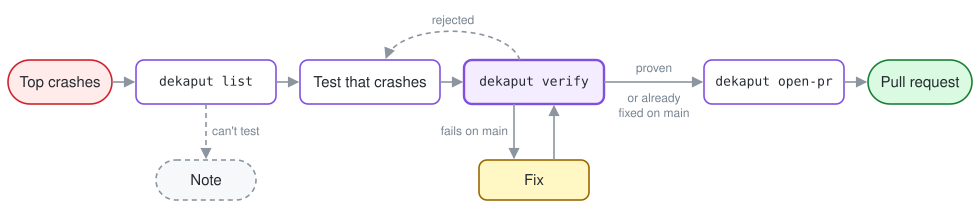

# de-kaput

Your app went kaput. de-kaput reproduces the crash with a test, fixes it, and opens a pull request with the test and the fix.

It never fixes blind: no pull request without a test that fails with the crash's own exception before the fix and passes after it. A person always reviews and merges.

> **Status: early.** One Android crash has gone end to end, from Crashlytics to a pull request with its test. The Xcode runner has proven a crash in a Swift package and a UIKit crash in an app with app-hosted tests.
>
> See it on two demo forks, each with crashes planted on purpose: Google's [architecture-samples](https://github.com/vaazh-studios/de-kaput-demo-architecture-samples/pull/1) (a Kotlin coroutine crash) and [NetNewsWire](https://github.com/vaazh-studios/de-kaput-demo-netnewswire/pull/1) (a Swift trap in its feed parser). On a harder crash in each, a fresh agent that was given only this runbook, the repo and the crash report found the cause and opened the PR: a sort comparator that breaks Java's contract, which never appears in the stack ([architecture-samples#2](https://github.com/vaazh-studios/de-kaput-demo-architecture-samples/pull/2)), and a `Data` slice indexed from 0 two commits after it was made ([NetNewsWire#2](https://github.com/vaazh-studios/de-kaput-demo-netnewswire/pull/2)).

## How it works



1. Your coding agent (Codex or Claude Code) reads the latest release's top crashes from Crashlytics through the Firebase MCP server.
2. `dekaput list` skips crashes that already have a pull request and puts the rest in a queue.
3. **For each crash in the queue, one at a time**, like Dependabot does for each dependency:
   - it finds the commit that crash was built from: the git revision Crashlytics recorded for the build, or your release tag;
   - the agent checks out a new git worktree on a fresh branch from your default branch, so your own checkout is never touched, and writes a test that reproduces the crash, then fixes it;
   - `dekaput verify` proves it in throwaway worktrees: the test fails on your default branch with the crash's exception, reaching the crash's code, and passes with the fix, and no test that passes on your default branch fails with it. If the test already passes on your default branch, it runs on the crash's commit instead; crashing there means the crash is already fixed and not yet shipped;
   - `dekaput open-pr` refuses without that proof, then opens a pull request for that crash with the test, the fix and the proof.
   A crash no test can reach gets a note on the Crashlytics issue instead, and the run moves on.
4. You get **one pull request per crash**, each reviewed and merged on its own. `--max-prs` caps how many are open at once.

Built for native Android, native iOS and Kotlin Multiplatform apps: Gradle runs the JVM tests, and `xcodebuild` runs XCTest and Swift Testing on an iPhone simulator (Xcode 16 or newer). On iOS a crash's identity is its Mach exception or signal (`EXC_BREAKPOINT`, `EXC_BAD_ACCESS`, `SIGABRT`) or its NSException name, read from the crash log the simulator writes.

## Configuration

Add `.github/de-kaput.yml` to your app's repo, next to `dependabot.yml`:

```yaml
version: 1
open-pull-requests-limit: 5        # most de-kaput PRs open at once
reviewers: [your-github-name]      # asked to review every PR

apps:
  - name: android
    platform: android              # android or ios
    crashlytics-app-id: "1:1234567890:android:abc123"
    packages: [com.example.app]    # your app's own Kotlin and Java code
    ignore-frames: [com.example.app.crashreporting]   # your crash reporter, never the cause
    probes: ["crash-reporting canary"]                # errors you raise on purpose
    release-tags: ["android/v{version}-{build}", "v{version}-{build}"]
    modules:                       # where tests live, and what runs them
      - path: app
        gradle-task: ":app:testDebugUnitTest"
      - path: shared
        gradle-task: ":shared:testAndroidHostTest"

  - name: ios
    platform: ios
    crashlytics-app-id: "1:1234567890:ios:def456"
    modules:
      - path: ios                  # "." when the Xcode project is at the repo root
        xcode-scheme: App
        xcode-workspace: App.xcworkspace   # or xcode-project; neither for a Swift package
        xcode-args: ["CODE_SIGNING_ALLOWED=NO"]   # optional: what your CI passes to xcodebuild
```

With it, the commands need no app-specific flags: `list` takes each crash's app by platform, and `verify` finds the Gradle task or Xcode scheme from the module that holds the new test. On iOS your app's own code is its Swift and Objective-C files in the repo, so `packages` only matters for Kotlin Multiplatform code; `xcode-destination` picks a simulator (otherwise an iPhone on the newest iOS installed), or `platform=macOS` for a package whose tests run on the Mac. Flags still win over the file. A mistake in the file is named, not guessed (`unknown key "open-pr-limit"`).

## Setup

On the machine the agent runs on: steps 1 to 4 once per machine, 5 and 6 once per app repo.

1. **Install the CLI** with `npm install -g github:vaazh-studios/de-kaput` (Node 20 or newer). It puts `dekaput` on the PATH and installs the runbook with it, so the two always match. Once the package is on npm, `npm install -g @vaazh-studios/de-kaput` does the same.
2. **Give the agent Crashlytics** through the Firebase MCP server, loaded with only the tools the runbook uses: top issues, sample events, notes, and the reports guide. Nothing that can deploy, create or change a project.
   - Claude Code: `claude mcp add firebase -- npx -y firebase-tools@latest mcp --tools crashlytics_get_report,crashlytics_batch_get_events,crashlytics_list_notes,crashlytics_create_note,firebase_read_resources` (add `-s project` to share it with your team in `.mcp.json`).
   - Codex, in `~/.codex/config.toml`:

     ```toml
     [mcp_servers.firebase]
     command = "npx"
     args = ["-y", "firebase-tools@latest", "mcp", "--tools", "crashlytics_get_report,crashlytics_batch_get_events,crashlytics_list_notes,crashlytics_create_note,firebase_read_resources"]
     ```
3. **Sign in to Firebase** with `npx firebase-tools login`, as an account that can see the app's Crashlytics. Writing the `de-kaput:` notes needs write access to Crashlytics.
4. **Sign in to GitHub** with `gh auth login`, as an account that can push branches to the repo. `open-pr` pushes the fix branch and opens the pull request; it never pushes to the default branch.
5. **Commit `.github/de-kaput.yml`** to the default branch (see Configuration).
6. **Tell the agent about de-kaput.** Both point it at the runbook installed with the CLI:
   - Claude Code: copy `skills/de-kaput/` into your project's `.claude/skills/`.
   - Codex: add one line to your project's `AGENTS.md`: "To fix a Crashlytics crash, follow the de-kaput runbook installed with the CLI, `$(npm root -g)/@vaazh-studios/de-kaput/RUNBOOK.md`: one crash at a time, one pull request per crash."

The app's tests must also run on that machine: Gradle with its `local.properties`, or Xcode with an iPhone simulator.

Then ask the agent to "fix the latest release's crashes with de-kaput". It reads the release's top crashes through the MCP server, runs `dekaput list`, and works through the queue one crash and one pull request at a time, as the runbook says.

## License

Apache-2.0
